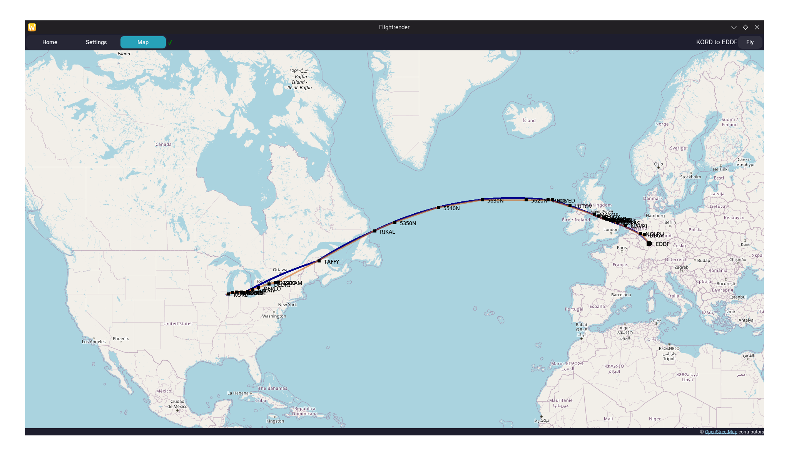

# Flightrender

An app for flight simming that is free and works with Linux. A lot of apps made for purposes like Flightrender are paid, and if they are free, they are Windows only,
so I made my own. 

The app can download Simbrief flight plans, show them on a map along with your flight path, and log your flights.

## Contributing

We need support for more flight sims, you can add them to `src/sim-name` and submit a PR.
